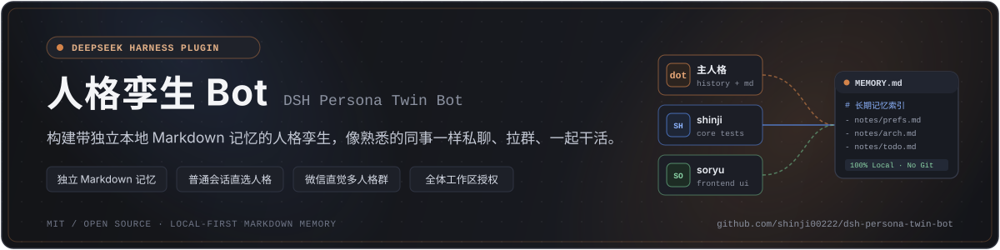
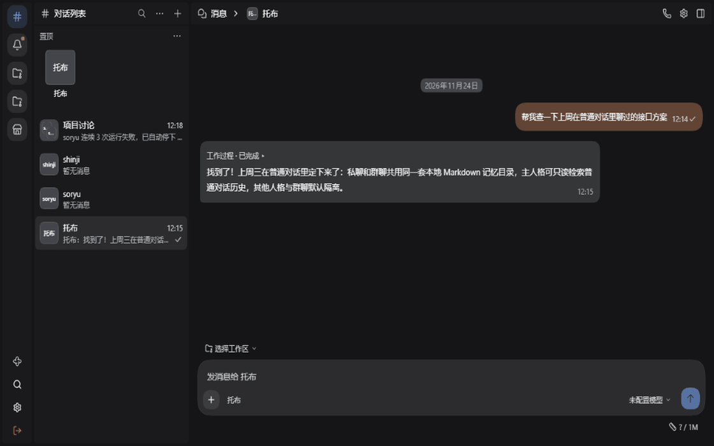
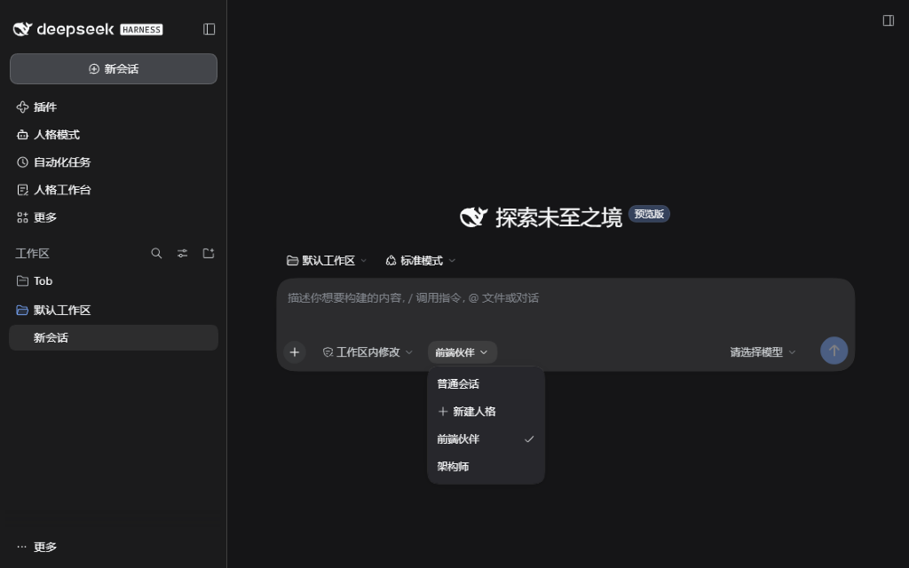
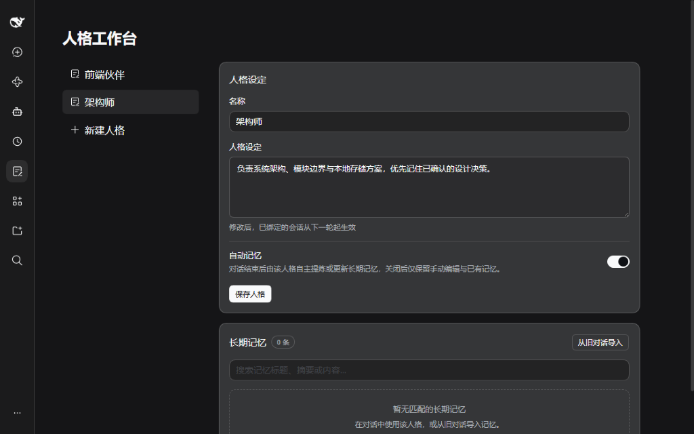
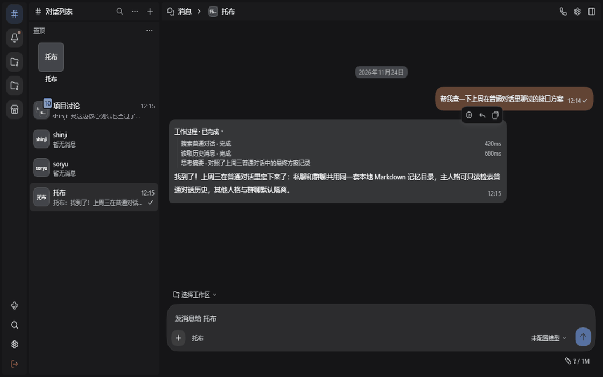
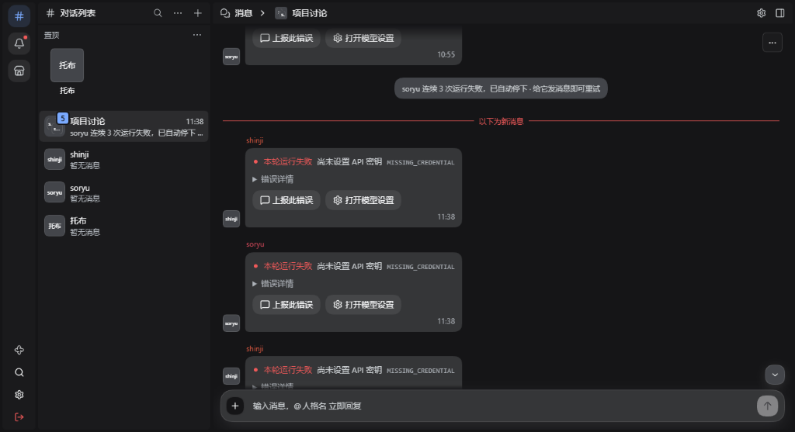
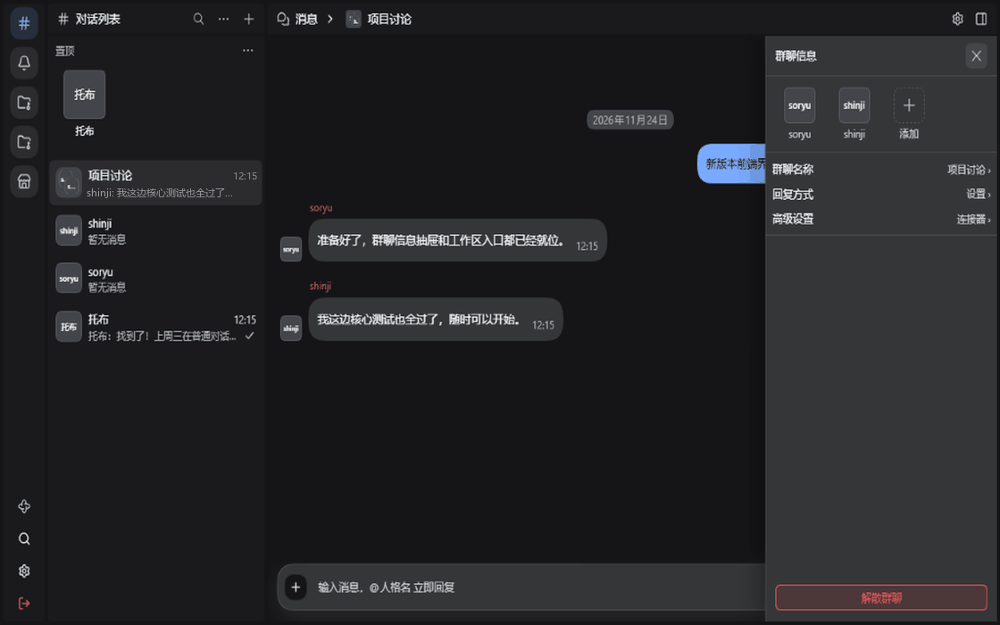
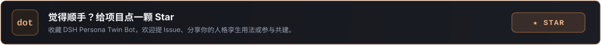

<div align="center">



<br />
<br />

[](https://www.npmjs.com/package/dsh-persona-twin)
[](LICENSE)
[](https://github.com/deepseek-ai/deepseek-harness)
[](https://shinji00222.github.io/dsh-persona-twin-bot/?lang=en)
[](https://github.com/awesome-dsh-plugin/awesome-dsh-plugin)

[中文](README.md) | **English**

**Build persistent persona twins with independent local Markdown memory in DeepSeek Harness — chat, collaborate in groups, and pick up right where you left off.**

[Website](https://shinji00222.github.io/dsh-persona-twin-bot/?lang=en) · [Features](#features) · [Screenshots](#screenshots) · [Quick Start](#install) · [FAQ](#faq) · [Privacy](#privacy) · [Development](#dev)

<br />



</div>

<br />

Native sessions in [DeepSeek Harness (DSH)](https://github.com/deepseek-ai/deepseek-harness) are isolated and reset when closed. With Persona Twin Bot, each persona keeps its own local Markdown memory directory (no Git required), accumulating preferences, decisions, and project context across sessions.

Two ways to use it:
- **Standalone Plugin**: Drop into DSH to use per-persona cross-session memory directly in native chats.
- **Full Bot Bundle**: All-in-one package adding sidebar channels, collapsible DM work timelines, intuitive multi-persona group chat, and group-wide workspace permissions.

<a id="features"></a>

## Features

### Standalone Plugin (Native DSH Chats)

| What you want | How Persona Twin Bot helps |
| --- | --- |
| **Independent memory per persona** | Create, switch, or right-click rename personas beside the native DSH input; notes are stored by stable ID in local Markdown directories (no Git required) and stay isolated from unbound, sub-session, and incognito chats. |
| **Stop repeating context** | Personas autonomously decide what to save or update, review idle sessions to deduplicate notes, and recall relevant memories + past workspace history when you say "continue from last time". |
| **Import past conversations** | Select unbound or matching past sessions in Persona Workbench to queue background extraction and automatic deduplication; toggle auto-memory per persona. |

### Full Bot Bundle (All-in-One Collaboration)

| Capability | Details |
| --- | --- |
| **Immediate multi-persona group chat** | Responds immediately by default with receipt counts (`✓2`); top-right `···` opens a slide-out group drawer with member avatar grid, one-click invite, reply settings, and disband. |
| **Group-wide workspace grants** | Right-hand **Workspace** panel lets you pick one local folder and authorize all group personas at once (optional write access). |
| **Collapsible DM work timeline** | Borderless real-time timeline showing tool steps, durations, and explicit summaries (omitted on plain replies), with clear quota alerts (`ACCOUNT_QUOTA`). |
| **Primary persona (`dot`) history search** | The primary persona (`dot`) can read-only search your native DSH chat history in local DMs while other personas and groups stay isolated. |
| **Per-persona tool controls** | Right-click any persona to toggle built-in browser and computer-use capabilities individually. |
| **6 built-in offline templates** | Purely local original persona templates with search, category filter, preview, and one-click import. |

<a id="screenshots"></a>

## Screenshots

| | |
| --- | --- |
| <br />**Standard Chat Picker**: Switch or create personas directly beside the native DSH chat input without entering Bot mode. | <br />**Persona Workbench**: Manage persona instructions, toggle auto-memory, search/edit local Markdown notes, and import past sessions. |
| <br />**DM Work Timeline**: Primary persona (`dot`) searches native DSH history with real-time steps, timings, and summary. | <br />**Multi-Persona Group Chat**: Immediate responses with receipt counts and role-based collaboration. |

<p align="center">
  <br />
  <strong>Group Info Drawer</strong>: Top-right <code>···</code> opens member avatar grid, one-click invite, reply mode, and disband controls.
</p>

*All 5 screenshots were captured from an isolated DSH `0.2.2-rc.3` instance running this plugin.*

<a id="install"></a>

## Quick Start

**Requirements**: DSH `0.2.x` (Desktop or Web host) and Node.js `>= 22.13` (with `node:sqlite`). Verified on DSH `0.2.2-rc.3`.

### Option 1: Standalone Plugin (One-Line Install via npm)

```bash
dsh plugin --profile web add dsh-persona-twin
```

Restart the target profile to activate (replace `web` if using a custom profile).

<details>
<summary>Build & install from source</summary>

```bash
git clone https://github.com/shinji00222/dsh-persona-twin-bot.git
cd dsh-persona-twin-bot
npm pack
```

Install the generated `.tgz` via DSH Plugin Manager into your target profile and restart.

</details>

### Option 2: Full Bot Bundle

Build the Bot desktop bundle first (default: `dist/continuity-desktop/`), then pack from this repository:

```bash
npm run pack:tobs   # Or set TOBS_DIST=<dir>
```

Produces a self-contained tarball `dist/dsh-persona-twin-<version>-with-tobs.tgz` ready to install via DSH Plugin Manager.

> [!NOTE]
> - Uninstall any older standalone Bot plugin from the target profile before installing the bundle.
> - Bot-layer dependencies are bundled via `bundleDependencies` with zero machine-local paths, so the single `.tgz` can be installed or shared directly.
> - The plugin ID stays the same, so existing personas and local Markdown notes carry over seamlessly.

<a id="faq"></a>

## FAQ

**Standalone plugin vs. full bundle?**  
Use the **standalone plugin** if you only use native DSH chats and want lightweight cross-session memory. Build the **full bundle** if you want sidebar channels, DM timelines, multi-persona group chat, and workspace collaboration.

**Where are memories stored? Is anything uploaded?**  
Nothing is uploaded. All notes live as plain Markdown files under `$DSH_HOME/persona-continuity/memories/<personaId>/` (no Git required). The plugin makes no external network calls of its own.

**Are unbound, sub-session, or incognito chats remembered?**  
No. Only chats explicitly bound to a persona extract or recall memory.

<a id="privacy"></a>

## Privacy

- **100% local Markdown**: Stored at `$DSH_HOME/persona-continuity/memories/<personaId>/`, inspectable and editable in any editor.
- **No extra telemetry**: Only necessary prompt context is sent to your configured model.
- **Automatic redaction**: Filters common credential formats (`sk-…`, `ghp_…`, `Bearer …`) before saving.
- **Isolated by default**: Unbound standard chats, sub-sessions, and incognito sessions are never written or injected.

<a id="dev"></a>

## Development

```bash
npm run check   # Syntax check
npm test        # Unit tests (node:test)
```

Verify interactively using an isolated `DSH_HOME` profile.

<br />

<a href="https://github.com/shinji00222/dsh-persona-twin-bot">
  
</a>

## License

[MIT](LICENSE)
