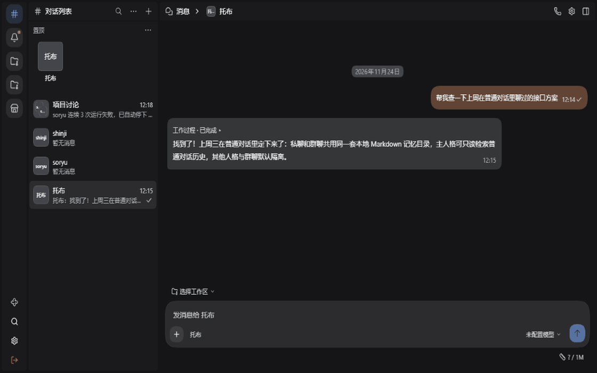
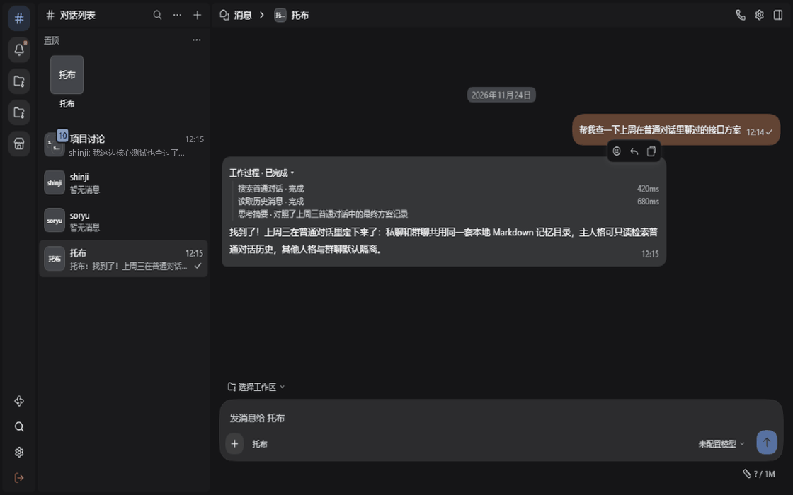
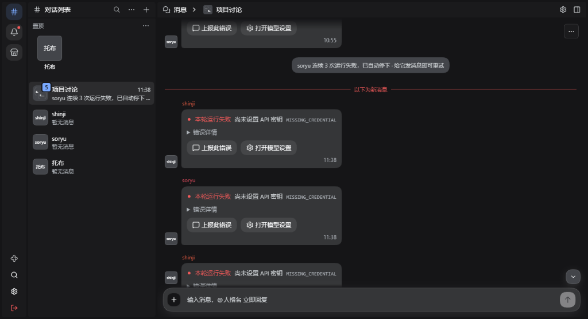
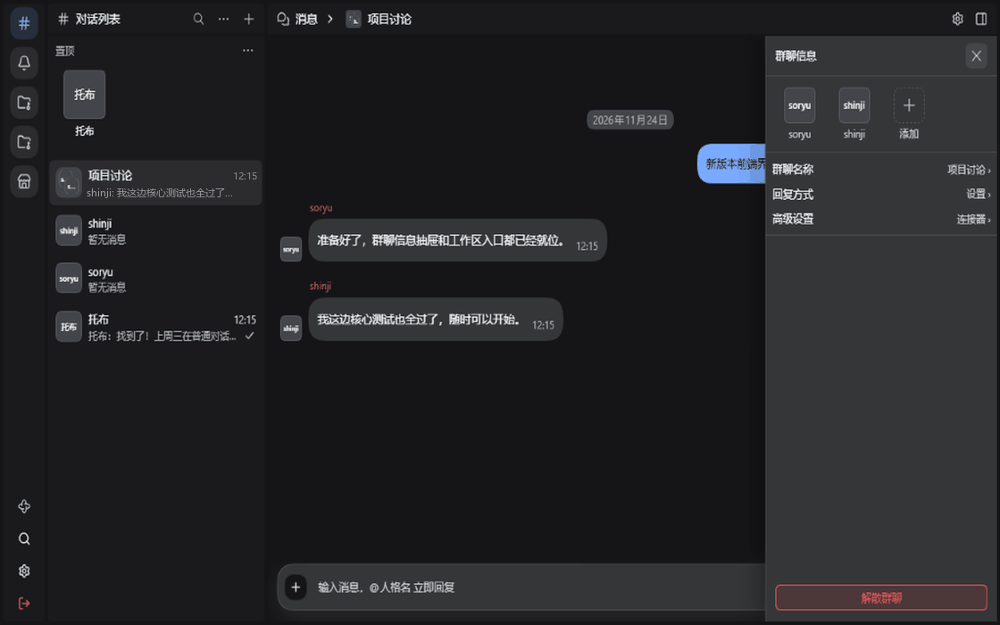

<div align="center">

# 人格续忆 Bot

**DSH Persona Continuity Bot**

[](LICENSE)
[](https://github.com/deepseek-ai/deepseek-harness)
[](package.json)

**给 DeepSeek Harness 的每个人格一份独立的跨会话记忆，像熟悉的同事一样私聊、拉群、一起干活。**

[核心能力](#features) · [快速上手](#install) · [怎么用](#usage) · [数据与隐私](#privacy) · [开发](#dev)

<br />



</div>

<br />

[DeepSeek Harness（DSH）](https://github.com/deepseek-ai/deepseek-harness) 的原生会话彼此独立，关掉就忘。装上这个插件后，每个人格都有自己独立的本地 Markdown 记忆目录（无需 Git），换新会话照样记得你的偏好、决定和项目进度。

它有两种用法：
- **纯插件模式**：直接装进 DSH，在普通会话里用多人格跨会话记忆。
- **合并包模式（含 Tobs Bot）**：基于开源项目 [DeepSeekBot（Tobs）](https://github.com/BotHarness/DeepSeekBot) 做了日常高频增强，一步装齐私聊、多人格群聊、工作过程时间轴和工作区管理。

<a id="features"></a>

## 核心能力

### 1. 人格跨会话记忆（纯插件自带）

- **每个人格独立记忆**：新建、切换、重命名人格，笔记按稳定 ID 存在本地 Markdown 目录（无需 Git），随时能自己翻看、改写或删除；普通会话、子会话和无痕会话完全隔离。
- **不用反复交代背景**：人格自己决定记什么、更新什么，空闲时自动回顾新对话并合并重复笔记；新会话直接说「继续上次」，就能按句召回记忆并翻查同工作区旧对话。
- **旧对话一键导入**：可以把未绑定或属于当前人格的历史会话导入记忆库，后台排队提炼并自动去重。

### 2. Bot 模式增强（合并包相比原版 DeepSeekBot / Tobs 新增）

| 能力 | 做了什么增强 |
| --- | --- |
| **微信直觉群聊** | 默认立即响应（不用等攒条数或 30 秒），气泡显示已收到人数（`✓2`）；右上角 `···` 展开群聊信息抽屉，成员头像宫格、`+` 一键拉人、解散群聊一目了然。 |
| **群聊「全体」工作区授权** | 私聊和群聊右侧边栏直达 **工作区** 面板；群聊点 **「全体」** 选一次本地目录，就能一次性授权给全群人格（可选允许写入）。 |
| **私聊工作过程时间轴** | 托布与其他人格私聊共用极简无框折叠时间轴，实时展示工具步骤、耗时和显式摘要，纯文本直回自动省略；额度不足（`ACCOUNT_QUOTA`）直接给中文提示。 |
| **主人格查普通 DSH 历史** | 唯一主人格（托布）在本地私聊里可只读搜索、翻看普通 DSH 对话记录，其他人格与群聊默认隔离。 |
| **按人格控制内置权限** | 右键人格可单独开关浏览器控制与电脑控制（Computer Use），避免一刀切授权。 |
| **本地精选人格模板** | 移除上游外部人格市场请求与发布入口，改为纯本地内置 6 个原创实用人格模板（支持搜索、分类筛选、预览设定与一键导入）。 |

### 界面一览

| 私聊工作过程时间轴 | 微信直觉多人格群聊 | 群聊信息抽屉 |
| :---: | :---: | :---: |
|  |  |  |
| 检索普通对话、耗时与思考摘要一目了然 | 默认立即响应，多人格协作不卡顿 | 头像宫格、一键拉人、群设置与解散 |

<a id="install"></a>

## 快速上手

**环境要求**：DSH `0.2.x`（带 Web 客户端的桌面版或 Web 宿主）、Node.js `>= 22.13`（需支持 `node:sqlite`）。已在 DSH `0.2.2-rc.3` 验证。

### 方式一：纯插件包（只要跨会话人格记忆）

```bash
git clone https://github.com/shinji00222/dsh-persona-continuity-bot.git
cd dsh-persona-continuity-bot
npm pack
```

把生成的 `.tgz` 通过 DSH 插件管理器装进目标 profile，重启即可。

### 方式二：合并包（人格续忆 + Tobs Bot 模式，推荐）

直接去 [Releases](https://github.com/shinji00222/dsh-persona-continuity-bot/releases) 下载 `dsh-persona-continuity-<版本>-with-tobs.tgz`（单文件自包含，含完整 Bot 模式、微信直觉群聊、本地精选人格模板），通过 DSH 插件管理器装进目标 profile 并重启即可，不用再单独装 `deepseekbot`。

如果需要自己从源码重打合并包（先在 Tobs 仓库构建好产物，默认在 `dist/continuity-desktop/`）：

```bash
npm run pack:tobs   # 可用 TOBS_DIST=<目录> 指定 Tobs 产物位置
```

会生成单文件自包含的 `dist/dsh-persona-continuity-<版本>-with-tobs.tgz`（无本机路径依赖，可直接发给别人安装）。

> [!NOTE]
> - 装合并包前先从 profile 卸掉单独的 `deepseekbot`，避免重复加载。
> - 插件 ID 不变，切换方式后已有人格和记忆照常保留。

<a id="usage"></a>

## 怎么用

从 DSH 左侧面板打开 **「人格工作台」**，可以新建人格、改设定和管理记忆：

1. **选人格**：新会话输入框旁点「普通会话」，选一个人格或点「＋ 新建人格」（右键可重命名）；已有普通会话也可以直接绑定到某个人格并自动提炼入库。
2. **改设定与看记忆**：在 **「设置 → 人格续忆」** 里编辑人格设定、查看或删掉某条记忆，也可以按人格单独关掉自动记忆。
3. **接上上次的活**：新开会话直接说「继续上次」，或者按主题让它翻一下同工作区的历史对话。

<a id="privacy"></a>

## 数据与隐私

- **全本地存储**：记忆写在 `$DSH_HOME/persona-continuity/memories/<personaId>/`（纯 Markdown，无需 Git），不上传、不跨设备同步。
- **不额外联网**：提炼与召回只把必要正文发给当前会话配置的模型，插件本身没有外部上报。
- **自动脱敏**：提炼入库前会自动过滤常见凭据格式（`sk-…`、`ghp_…`、`Bearer …` 等）。
- **默认隔离**：普通会话、子会话和无痕会话不写入、不注入任何记忆。

<a id="dev"></a>

## 开发

```bash
npm run check   # 语法检查
npm test        # 单元测试
```

验收时请用隔离的 `DSH_HOME` 启动 profile，覆盖普通会话默认行为、多人格并行、重启后记忆召回与编辑删除。

<details>
<summary>项目结构与内部设计文档</summary>

| 路径 | 作用 |
| --- | --- |
| `index.js` | 宿主入口：人格注入、提炼队列、历史检索 |
| `client.js` | Web 客户端：人格菜单、设置页与记忆管理 |
| `lib/store.js` | 人格、会话绑定、提炼队列与凭据过滤 |
| `lib/local-memory.js` | 本地 Markdown 笔记与 `MEMORY.md` 索引读写 |
| `lib/extract.js` | 模型调用与结构化解析 |
| `lib/history.js` | 旧对话检索与范围隔离 |
| `lib/web.js` | 复用 DSH 鉴权的管理路由 |
| `test/` | `node:test` 单元测试 |
| `scripts/pack-with-tobs.mjs` | 打包人格续忆 + Tobs Bot 模式合并包 |

相关文档：[技术调研](docs/research.md) · [项目规划](docs/project-plan.md) · [Tobs 接入调研](docs/tobs-integration-research.md) · [Tobs 接入规划](docs/tobs-integration-plan.md) · [开发记录](docs/development-log.md)

</details>

## 许可

[MIT](LICENSE)
